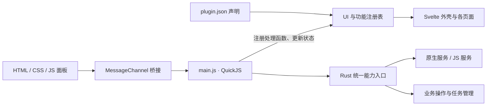

# Hydrogen JavaScript 插件能力与 UI 扩展方案

更新日期：2026-11-05  
状态：设计草案，待实施  
适用工程：`tauri/`

## 1. 目标与总体决策

采用 **QuickJS 业务运行时＋统一能力入口＋声明式 UI 扩展点＋隔离 HTML 面板**，在现有插件机制上补齐能力调用、UI 注册、功能提供者和生命周期管理。

插件作者仅使用 `plugin.json + .js + HTML/CSS`，即可调用启动器的大部分业务能力、注册主界面入口，并提供新的功能实现。安装、升级和调试这类插件不需要 Rust、Node.js、DLL 编译或重新构建启动器。

宿主需要先发布支持新协议的版本。之后，在已有能力和扩展点范围内增加插件，只需安装插件包；新增宿主尚未实现的系统能力或扩展点，仍需要升级相应宿主或能力提供者。

本文中的新增 API、扩展点和清单字段均为拟议设计，不代表当前版本已经支持。

### 1.1 预期结果

- 插件能调用实例、账号、Java、资源、模组、整合包、下载、任务、设置等主要业务能力。
- 插件能在侧栏、首页、设置、实例页面、工具栏、菜单和其他明确开放的位置注册 UI。
- 插件能注册命令、服务、事件处理、流程 Hook 和业务提供者。
- 插件升级和重载能够统一处理 UI、订阅、任务、资源句柄和运行时状态。
- 普通 JavaScript 插件保持零构建开发方式，继续通过 `.hplugin` 分发。

### 1.2 继续复用的基础

- QuickJS 执行业务脚本，Svelte 承载宿主界面。
- 现有 `PluginHost`、原生服务、任务管理和插件包校验。
- 现有 `.hplugin` 包格式、开发目录加载、候选版本验证与重载提交机制。
- 声明式 UI 和隔离 HTML 面板两种界面形式。

相关设计基础见[原重构方案](../../tauri-rebuild-plan.md)。

## 2. 当前实现与差距

现状依据为本次方案审阅时的工作区源码。

| 方面 | 当前实现 | 需要补齐的部分 |
| --- | --- | --- |
| JavaScript SDK | 命令注册、实例列表、通知 | 业务 API、服务调用、任务、事件、存储等能力 |
| 服务路由 | 服务提供者限定为原生插件 | JS 消费和提供服务；普通命令也获得路由上下文 |
| UI 清单 | 只有命令和隔离面板 | 主侧栏、设置、工具栏、标签页及其他位置贡献 |
| 主页面接入 | Svelte 显式导入和固定页面分支 | 按注册表发现并展示外置插件贡献 |
| 面板通信 | 只能执行本插件无参命令 | 参数、结构化错误、事件、进度和取消 |
| 面板会话 | 打开新面板撤销前一个面板 | 多个已挂载视图各自拥有独立会话 |
| JS 调度 | 共用串行调度线程，等待单次操作完成 | 等待 I/O 或服务时继续处理其他插件 |
| 执行时间 | 当前单次操作限时三秒 | 区分 CPU 限额、请求超时和长任务生命周期 |
| 插件变更锁 | 命令执行期间持有全局锁 | 短状态锁和在途调用、任务的依赖保护 |
| 业务提供者 | 账号、资源源、加载器存在固定分支 | 可发现、可选择、可调用的提供者契约 |

主要源码入口：

- [JavaScript SDK](../plugin-sdk/launcher.d.ts)
- [清单校验](../src-tauri/src/plugins/manifest.rs)
- [插件宿主与服务路由](../src-tauri/src/plugins/host.rs)
- [QuickJS 运行时](../src-tauri/src/plugins/runtime.rs)
- [JS 启动桥接](../src-tauri/src/plugins/bootstrap.js)
- [面板会话管理](../src-tauri/src/plugins/panel.rs)
- [桌面命令与业务入口](../src-tauri/src/desktop.rs)
- [主界面外壳](../official-plugins/ui.shell/frontend/App.svelte)
- [面板组件](../official-plugins/ui.shell/frontend/components/PluginPanel.svelte)

## 3. 总体架构



各部分职责如下：

1. 清单声明插件可能贡献的命令、视图、菜单和功能提供者。
2. QuickJS 注册处理函数并编排业务逻辑。
3. Rust 入口识别调用者，检查权限、参数、资源范围和生命周期，再分发到业务操作或服务。
4. UI 注册表向 Svelte 外壳及各页面提供贡献数据。
5. 简单 UI 由宿主渲染；复杂 UI 由静态 HTML 面板承载，通过消息桥接调用本插件业务。

## 4. 统一能力调用

### 4.1 业务 API

业务 API 直接表达“修复实例”“安装资源”“修改设置”等操作，作为插件作者的主要入口。

| API 组 | 拟开放的能力 | 主要复用位置 |
| --- | --- | --- |
| `ctx.instances` | 列表、创建、选择、重命名、配置、修复、删除、启动 | 实例服务及现有业务操作 |
| `ctx.accounts`、`ctx.java` | 档案管理、登录流程、Java 扫描与校验 | 账号和 Java 插件 |
| `ctx.resources`、`ctx.mods`、`ctx.modpacks` | 搜索、安装、导入导出、启停、更新 | 资源、模组、整合包插件 |
| `ctx.settings`、`ctx.storage` | 设置读取与字段更新、插件私有持久化 | 配置与存储实现 |
| `ctx.http`、`ctx.files`、`ctx.process` | 网络请求、下载、文件操作、受授权的进程操作 | 网络、文件、下载及平台插件 |
| `ctx.tasks`、`ctx.events`、`ctx.log` | 任务进度、取消、事件订阅、日志 | 任务管理与诊断实现 |
| `ctx.ui` | 导航、通知、对话框、视图状态、主题信息 | 外壳和 UI 注册表 |
| `ctx.services` | 查询、调用、注册带版本的公开服务 | 扩展后的 `PluginHost` |

主界面和 JS 插件必须使用同一套业务操作。以修复实例为例，任务登记、实例占用检查、目录校验和进度更新都应在共同入口完成。

实施时，将 `desktop.rs` 中需要复用的业务编排整理成可独立调用的操作。Tauri 命令和 JS 能力入口分别完成调用来源校验后，进入这些操作。避免为 JS 再维护一份行为不同的安装、启动或设置逻辑。

设置更新优先采用受校验的字段更新，保留已有配置校验和实例运行状态约束。

### 4.2 服务 API

服务 API 用于调用更细的公开能力，以及让插件向其他插件提供服务。

拟议调用形式：

```js
await ctx.services.call({
  provider: 'java.runtime',
  service: 'java.runtime',
  version: '^1',
  method: 'parse',
  params: { path: 'java.exe', output: properties }
});
```

拟议注册形式：

```js
ctx.services.register('example.tools', {
  summarize: async (params) => {
    // 返回 JSON 或 Promise<JSON>。
    return { instanceId: params.instanceId };
  }
});
```

服务注册需要与清单中的 `provides` 声明对应。调用方继续声明提供者依赖，并分别检查插件版本和服务契约版本。

服务目录至少记录：

- 提供者、服务 ID、版本及公开方法。
- 输入输出类型和消息大小限制。
- 所需能力及资源范围。
- 执行方式、超时和取消语义。
- 是否返回任务或其他资源句柄。

现有原生方法中，接收任意路径、进程参数或内部句柄的方法，需要先补参数约束或业务适配，再向 JS 开放。面向插件的服务目录应逐项标明开放情况。

### 4.3 调用身份与资源范围

Rust 根据真实调用来源建立上下文，至少包括：

```text
pluginId
generation
调用链
授权的资源范围
取消信号
```

身份来自宿主绑定的运行时或面板会话，不能由消息里的 `pluginId` 决定。跨服务调用继续传递调用上下文，调用内置插件不会自动获得宿主身份。

文件目录、网络域名、进程和任务句柄按范围授权。业务操作可以在校验后派生执行所需的下游上下文。例如启动游戏由宿主使用凭据，普通插件获得账号信息和操作结果。

JS 请求的权限和授权变化继续纳入现有安装、升级与摘要校验机制。

## 5. UI 扩展点与注册表

### 5.1 稳定的位置契约

清单声明入口和展示方式，JS 注册处理函数。宿主中的每个位置负责收集贡献、排序、渲染和传递上下文。

| 界面位置 | 建议扩展点 | 支持的贡献 |
| --- | --- | --- |
| 主侧栏 | `sidebar.main`、`sidebar.footer` | 页面入口、命令入口、徽标 |
| 首页 | `home.widgets`、`home.actions` | 信息卡片、自定义区域、操作按钮 |
| 启动器设置 | `settings.sections` | 设置分组、标准字段、自定义设置页 |
| 实例设置与列表 | `instance.tabs`、`instance.toolbar`、`instance.contextMenu` | 标签页、工具按钮、右键菜单 |
| 模组与资源 | `mods.toolbar`、`mods.contextMenu`、`resources.actions` | 批量操作、详情操作、扩展工具 |
| 档案与任务 | `profiles.actions`、`downloads.taskActions` | 档案操作、任务操作 |
| 窗口与全局操作 | `titlebar.actions`、`status.items`、`commands.palette` | 标题栏按钮、状态项、命令及快捷键 |

扩展点需要在对应页面实际接入。新增清单字段本身不会自动产生页面入口。

### 5.2 注册规则

- ID 统一归属插件命名空间，避免不同插件覆盖彼此入口。
- 排序采用固定分组、数值顺序和稳定 ID，冲突结果可预测。
- 宿主提供 `instanceId`、`selectedModIds`、`taskId` 等位置上下文，执行时重新检查对象及权限。
- 可见性和可用性使用有限的条件字段，不执行任意表达式。
- 动态徽标、文案和状态通过 `ctx.ui.update()` 更新。
- 安装、停用、卸载和重载后更新注册表，界面同步增删入口。
- 注册返回可清理句柄，同时由宿主记录所属插件和 generation，保证停止时能够统一回收。

按钮、菜单、设置字段等简单内容由 Svelte 宿主渲染，使用现有样式、国际化和键盘交互。

官方页面可继续使用 Svelte，并逐步在同一注册表登记视图和操作；外置插件页面以静态 HTML 面板登记。

### 5.3 复杂界面与面板桥接

将现有 `PluginPanel.svelte` 扩展为通用插件视图容器，支持整页、标签页、卡片和弹窗尺寸。

面板会话从“全局只能存在一个”改为“每个已挂载视图有独立会话”。按可见性挂载，并限制同时挂载的数量。

桥接需要补齐：

- 命令参数和结构化结果、错误。
- 任务进度订阅与取消。
- 主题、语言和视图上下文通知。
- 生命周期结束、页面导航和插件重载后的会话撤销。
- 适合不同位置的尺寸协商。

继续使用隔离 iframe 和 `MessageChannel`，提供现成的 `bridge.js`，让作者不用手写握手协议。面板通过本插件业务调用能力，宿主在 Rust 边界重新检查权限。

## 6. 功能提供者、事件与 Hook

### 6.1 业务提供者

`provides` 解决“其他插件能调用此服务”。要成为资源源、账号提供者或加载器，还需要对应业务模块发现并使用该服务。

优先开放以下契约：

| 提供者类型 | 提供的实现 | 接入位置 |
| --- | --- | --- |
| `resourceSource` | 搜索、版本、依赖、下载计划 | 资源服务和资源页面 |
| `accountProvider` | 登录流程、档案信息、会话操作 | 账号管理与档案页面 |
| `loaderProvider` | 可用版本、安装计划、启动配置补丁 | 安装和启动流程 |
| `downloadSource` | 源信息、地址解析和下载策略 | 下载服务及源选择设置 |

清单中的提供者贡献引用已声明服务，并标明契约类型和版本。消费方按契约发现实现，处理可用性、用户选择和缺失依赖。

当前针对微软／离线、Modrinth／CurseForge、Fabric／Forge 的固定选择分支，需要改为按提供者契约分发。现有官方实现也登记到同一机制中。

提供者返回下载计划或启动补丁后，实际下载、文件提交和进程启动继续交给已有服务。JS 承担业务编排，大文件和耗时处理由宿主任务执行。

### 6.2 事件与流程 Hook

事件用于通知，例如 `instance.changed`、`task.updated`、`game.exited`。处理失败记录到插件诊断，不影响无关订阅者。

Hook 用于影响流程，例如 `beforeLaunch`、`beforeInstall`。处理函数返回受校验的结构化补丁或拒绝理由，并明确以下契约：

- 执行顺序与稳定排序。
- 多个补丁发生冲突时的处理方式。
- 超时和取消行为。
- 处理失败时继续还是终止流程。
- Hook 可读取的数据和可修改的字段。

### 6.3 激活时机

落实清单中的按需激活语义，覆盖命令调用、页面打开、服务或提供者被请求，以及显式声明的启动事件。

安装和浏览清单时不执行插件业务。激活依赖排序、错误状态和重复激活处理继续由宿主管理。

## 7. 运行时、任务与生命周期

### 7.1 调度调整

保留每个插件独立的 QuickJS Runtime。将“等待整个命令完成”的执行循环改为可以挂起调用的事件调度：一个插件等待网络或服务时，调度器继续处理其他插件；每个 Runtime 内的 JS 执行片段仍然串行。

必须同步调整：

- 命令接收 `params` 和调用上下文，原生命令获得一致的服务路由上下文。
- CPU 执行限额与 I/O 等待时间分开管理。
- 具体请求设置超时；安装、下载等长操作返回任务句柄。
- 原生同步服务在工作线程执行；需要系统 UI 线程的操作通过现有主线程执行器投递。
- 服务调用检查循环、深度和等待关系，覆盖 JS→原生、原生→JS、JS→JS。
- 保留并校准现有内存、请求数量和消息大小上限；大数据使用任务、分块或资源句柄传输。

不能仅扩大当前三秒超时来承载长任务，否则仍会阻塞其他脚本和生命周期操作。

### 7.2 锁与在途调用

全局插件变更锁缩短到状态变更阶段。在途调用和任务通过插件代次及依赖租约保护，避免整个命令等待期间占用全局锁。

卸载、替换提供者和重载必须检查在途使用情况。存在无法安全中断的游戏、安装提交或其他任务时，延后变更。

### 7.3 资源归属与停止

注册、订阅、面板、请求和句柄统一绑定 `pluginId + generation`。旧 generation 的响应不能修改新实例。

停止顺序：

1. 拒绝新请求和新的激活入口。
2. 取消可取消工作，并处理宿主已经接管的任务。
3. 执行有期限的插件清理。
4. 撤销命令、服务、提供者、事件订阅和 UI 注册。
5. 关闭面板及资源句柄，销毁 Runtime。

某项清理失败时，仍需继续清理其余资源。

### 7.4 重载与失败恢复

沿用现有候选验证和提交机制，将 UI 与功能注册纳入同一次切换。

候选准备阶段只建立待提交注册，产生外部写入的工作放到提交后启动。候选验证失败时保留旧运行时和旧注册；提交成功后撤销旧代资源并启用新代。

重载不能保证撤销已经发生的外部副作用。文件提交、任务恢复和插件私有持久化仍需按各自契约处理。

## 8. 免编译开发示例

以下示例展示目标开发体验，依赖本文拟议的新协议。

### 8.1 目录

```text
instance-tools/
  plugin.json
  main.js
  ui/
    index.html
    main.js
    style.css
    bridge.js
```

### 8.2 清单

```json
{
  "schemaVersion": 3,
  "apiVersion": 2,
  "id": "example.instance-tools",
  "name": "实例工具",
  "version": "1.0.0",
  "runtime": "javascript",
  "entry": "main.js",
  "permissions": ["instances.read", "instances.repair", "ui.contribute", "ui.panel"],
  "contributes": {
    "commands": [
      { "id": "repair", "title": "修复此实例" }
    ],
    "panels": [
      { "id": "overview", "title": "实例工具", "entry": "ui/index.html" }
    ],
    "views": [
      { "id": "tools-page", "location": "sidebar.main", "panel": "overview" }
    ],
    "menus": [
      { "location": "instance.toolbar", "command": "repair" }
    ]
  }
}
```

示例使用宿主业务 API，实例能力提供者的依赖由业务入口管理。直接调用其他插件服务的插件，应在自己的清单中声明对应提供者依赖。

### 8.3 业务代码

```js
export function activate(ctx) {
  ctx.commands.register('repair', async ({ instanceId }) => {
    const task = await ctx.instances.repair(instanceId);
    return { taskId: task.id };
  });
}
```

侧栏页面通过配套面板 SDK 调用同一个 `repair` 命令，并传入选中的实例。实例工具栏由宿主提供实例上下文。两条路径使用相同的处理函数和任务管理。

## 9. 版本与兼容策略

- 新增 `schemaVersion: 3` 表达清单扩展，新增 JavaScript API v2 表达 SDK 契约。
- 继续兼容现有 schema v2／API v1 插件。
- 原生 ABI v1 独立保留，清单和 JS API 升级不要求变更 DLL ABI。
- 旧命令适配为无参调用，旧面板继续能在插件详情中打开。
- 宿主明确报告不支持的版本、能力和扩展点，避免插件静默失效。
- 新权限继续通过安装或升级流程处理，重载不自动增加授权。

纯 JavaScript 作者保持零构建开发方式。SDK 类型声明提供编辑器提示，不要求执行 TypeScript 编译。

选择 TypeScript、Svelte 或其他前端工具的作者，可以自行构建为 JS 和静态资源后打包。安装端不解析 TS/JSX、不安装 npm 依赖、不执行包内安装脚本。

## 10. 实施阶段

| 阶段 | 主要修改 | 完成标志 |
| --- | --- | --- |
| 1. 打通能力和调度 | `host.rs`、`runtime.rs`、`bootstrap.js`、业务操作入口、SDK、清单版本支持 | JS 能传参调用业务和原生服务，提交并取消长任务，不阻塞其他插件 |
| 2. 开放 UI 注册 | 清单、注册表、`App.svelte`、各页面、面板容器 | 外置 JS 插件能添加侧栏页、设置项、实例标签和菜单，安装后自动出现 |
| 3. 开放功能提供者 | JS 服务处理、事件／Hook、账号／资源／安装消费者 | JS 提供者能被其他插件调用，并出现在实际业务选择入口中 |
| 4. 固化兼容与开发工具 | CLI、类型声明、示例、插件指南、重载和集成验证 | 旧插件继续工作，新插件可校验、测试、打包、重载，能力说明完整 |

第一条实现闭环使用现有 [example.instance-tools](../examples/instance-tools)：

1. 注册侧栏页面和实例工具栏按钮。
2. 从 UI 向命令传入实例 ID。
3. 调用真实实例修复操作，创建宿主任务。
4. 展示任务进度并支持取消。
5. 停用或重载插件，验证入口、订阅和面板清理。

该闭环同时验证免编译、能力调用、UI 注册、参数传递和生命周期。随后按服务目录和扩展点清单逐项接入其余能力。

## 11. 验收标准

### 11.1 能力与功能

- 使用纯 JS＋HTML 插件完成搜索资源、选择版本、安装到实例、显示进度并取消任务的真实流程。
- JS 插件提供服务，由另一个 JS 插件和原生测试插件分别调用。
- 新增一个资源源或加载器，只安装插件包即可出现在对应界面，不再修改外壳导入和固定分支。
- 直接服务调用和业务操作都保留权限、依赖版本、参数及资源范围检查。

### 11.2 UI 与生命周期

- 同一插件同时注册侧栏页、设置项、实例操作和事件处理，停用后全部清理。
- 多个可见插件视图可以共存，单个视图关闭不撤销其他视图的会话。
- 连续重载后没有重复按钮、残留订阅或旧响应串入。
- 重载候选失败时，保留可工作的旧版本和注册。
- 一个插件等待服务或长任务时，不阻塞其他插件命令、取消和状态更新。

### 11.3 免编译与兼容

- 在没有 Rust 和 Node.js 开发工具的环境中，安装、启用和使用纯 JS 插件。
- 修改开发目录中的 JS 或 HTML 后，通过校验重载生效。
- 现有 schema v2／API v1 示例和原生 ABI v1 插件继续工作。
- JS 服务互调、原生互调、循环调用和超时场景具有可复现的验证用例。

### 11.4 能力覆盖清单

对官方服务方法逐项登记并维护以下字段，作为“绝大多数能力”的验收依据：

| 字段 | 内容 |
| --- | --- |
| 能力与方法 | 提供者、服务 ID、方法名 |
| 开放方式 | 直接开放、适配后开放、原生限定 |
| 插件入口 | 对应业务 API 或公开服务调用 |
| 使用约束 | 权限、资源范围、版本、任务与取消语义 |
| 限定原因 | 原生限定或暂未开放的具体原因 |
| 验证依据 | 示例插件、集成用例或实际流程 |

## 12. 关联文档

- [当前插件开发指南](../PLUGINS.md)
- [原 Tauri 重构方案](../../tauri-rebuild-plan.md)
- [JavaScript SDK](../plugin-sdk/launcher.d.ts)
- [Rust 插件 SDK](../plugin-sdk/native/src/lib.rs)
- [服务调用与依赖测试](../src-tauri/tests/service_plugins.rs)
- [脚本、权限、面板与重载测试](../src-tauri/tests/plugins.rs)
